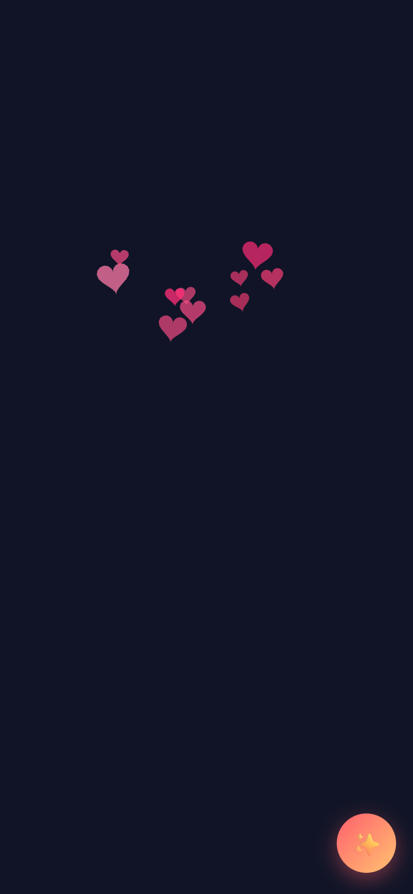
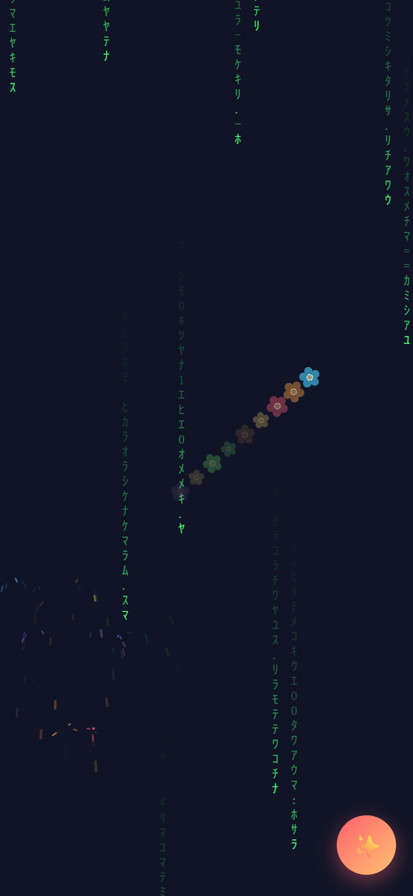
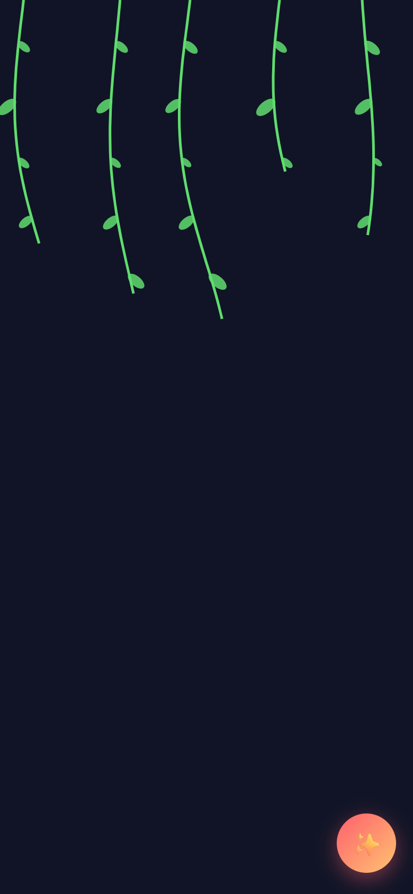

<div align="center">
  
  <h1>浮光画布 · LumaCanvas</h1>
  <p><b>点击成漪，滑动流影，背景轻呼吸。</b></p>
  <p>让日常浏览，多一层优雅光影。</p>
</div>

<br>

## 它是什么

一个为移动端浏览器而生的轻量插件。不喧哗，不打扰——只是当你指尖落下的时候，网页会开出一朵光。

纯原生 Canvas 手绘，零依赖，零外部请求。所有偏好只留在你自己的设备里。

<div align="center">
  
  
  
</div>

## 光的种类

**点击特效** —— 烟花、烟花波纹、爆炸、爱心、文字、彩带、闪粉、泡泡、水波、雪花。
也可以什么都不点（「无」）。

**滑动特效** —— 花朵、星光、爱心、泡泡。手指掠过屏幕，留下一路流影。

**背景** —— 水波纹、动态光斑、流光渐变、星空、极光、雨滴、飘雪、星点连线、漂浮爱心、鱼群游动、藤蔓生长、数字雨。

**背景颜色** —— 八种预设、任意自定义，或干脆留白（「无」）。

## 每一种光，都可以调

每个效果都有属于自己的设置项：

- 水波纹的「数量」，是**波纹的多少**；
- 数字雨的「大小」，是**字号**；
- 文字特效没有数量——它有**自己的内容**，和上浮的速度。

选中效果后再次点按（▾ 会展开），调到你喜欢的那一档。速度、多少、大小，光就长成了你的样子。

## 安装

**作为浏览器扩展**（Chrome / Edge / 其他支持扩展的浏览器）

1. 点击 `Code → Download ZIP`，解压（或直接 Clone 本仓库）；
2. 打开扩展管理，开启「开发者模式」；
3. 「加载已解压的扩展程序」，选择本仓库目录；
4. 点按工具栏中的浮光画布图标（✨）打开快捷面板。

安装后，你在任何网页上的每一次点击与滑动，都会带着光。完整设置在扩展选项页里。

**作为互动网页**（H5）

直接打开 `index.html` 即可体验，或在本目录起个静态服务：

```bash
python -m http.server 8000
```

## 目录

```
manifest.json   扩展清单（MV3）
index.html      设置页 / 互动应用入口
app.js          设置面板与主循环
content.js      网页注入运行时
fx.js           点击与滑动特效
bg.js           背景特效
popup.html/js   快捷面板
icons/          图标
```

## 一点说明

- 设置全部保存在本地（localStorage / chrome.storage），不收集任何数据；
- 页面不可见时动画自动暂停，尊重系统的「减少动态效果」；
- 反馈与联系：欢迎提 [Issue](https://github.com/oksummer/LumaCanvas/issues)，或点设置面板底部的「反馈 | 联系作者」。

<br>
<div align="center">
  <i>愿每一次点击，都不只是一次点击。</i>
</div>
